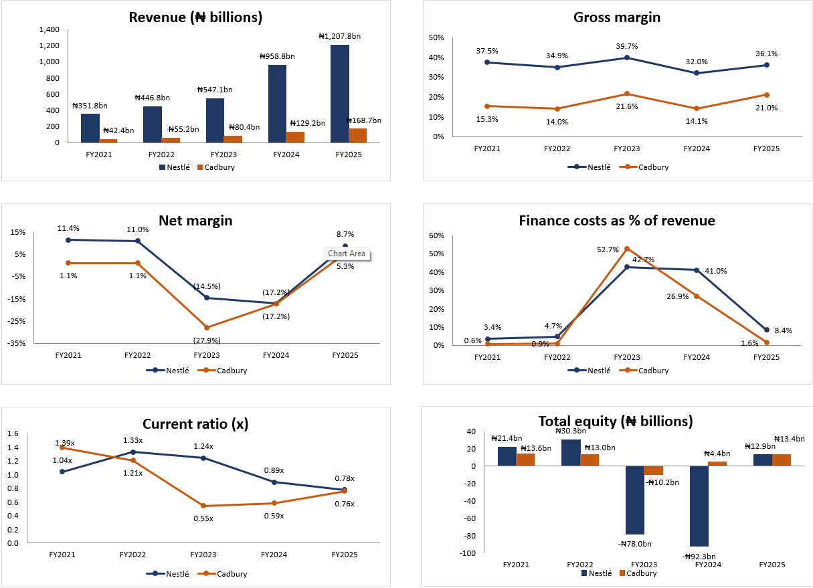
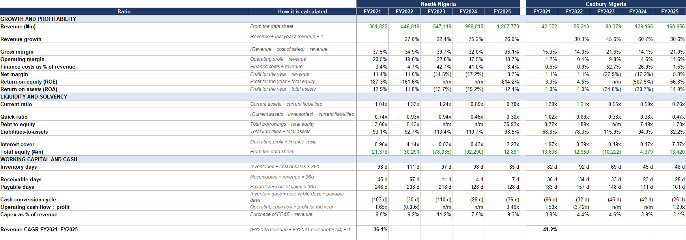

# Surviving the Naira Shock — Nestlé Nigeria vs Cadbury Nigeria (FY2021–FY2025)

**Author:** Daniel Elombi · Data Analytics for Business Decision Making, Durham College (Oshawa, ON)  
**Tools:** Microsoft Excel (formulas, ratio analysis, charts)  
**Data:** real, public figures from each company's audited annual reports. Amounts in ₦ millions unless stated. Analysis for learning, not investment advice.

## Business problem
In June 2023 Nigeria let the naira float closer to the market rate. The naira lost well over half its value against the US dollar, and inflation rose above 30% in 2024. An investment committee asked:

> **How did each company come through the naira shock, and which one is in the stronger financial position at the end of FY2025?**

I answered nine questions on growth, margins, FX losses, solvency, liquidity, working capital, cash and recovery.

## Data
| Company | Reports used | Statements |
|---|---|---|
| Nestlé Nigeria Plc | FY2021–FY2025 annual reports (5) | Profit or loss, financial position, cash flows, notes |
| Cadbury Nigeria Plc | FY2021–FY2025 annual reports (5) | Profit or loss, financial position, cash flows, notes |

Links to every report and the page numbers used are in the **Sources** sheet of the workbook.
- Nestlé Nigeria: [nestle-cwa.com/en/investors/nigeria](https://www.nestle-cwa.com/en/investors/nigeria)
- Cadbury Nigeria: [africanfinancials.com/company/ng-cadbur](https://africanfinancials.com/company/ng-cadbur/)

## What I did
- Extracted 25 line items × 5 years × 2 companies from the audited statements and notes; used the newest report where years overlapped (restatements).
- Built check rows (gross profit, balance sheet, tax) that reconcile to zero.
- Calculated 21 ratios and measures (margins, ROE/ROA, liquidity, solvency, working-capital days, cash conversion, CAGR) with error-proof formulas.
- Built 6 comparison charts and wrote a one-page memo.

## Key findings
1. **Growth:** revenue grew at a compound annual rate of 41.2% at Cadbury (₦42.4bn to ₦168.7bn) and 36.1% at Nestlé (₦351.8bn to ₦1,207.8bn) from FY2021 to FY2025. Growth peaked in FY2024 (+60.7% and +75.3%) when inflation was above 30%, so most of it reflects higher prices rather than higher volumes.
2. **The FX shock:** in FY2024 Nestlé made a ₦167.9bn operating profit, but finance costs reached ₦392.8bn (41.0% of revenue, including a ₦290.7bn FX loss), leaving a ₦221.6bn loss before tax. Cadbury's finance costs were 52.7% of revenue in FY2023 and 26.9% in FY2024, turning operating profits into losses.
3. **Solvency:** both companies ended up with negative equity: Nestlé ₦-78.0bn (FY2023) and ₦-92.3bn (FY2024), Cadbury ₦-10.2bn (FY2023). Cadbury's parent restored it in FY2024 (₦29.7bn of debt forgiven, ₦7.0bn of loans converted to shares); Nestlé's equity returned to ₦12.9bn only through FY2025 profit.
4. **Working capital / cash:** both run a negative cash conversion cycle in FY2025 (Nestlé -36 days, Cadbury -25 days), so suppliers finance their operations. FY2025 operating cash flow was 3.5x profit at Nestlé and 1.3x at Cadbury.
5. **Recovery:** the FY2025 return to profit came from higher gross margins (Nestlé 32.0% to 36.1%, Cadbury 14.1% to 21.0%) and finance costs falling to 8.4% (Nestlé) and 1.6% (Cadbury) of revenue as the naira stabilised.

## Verdict
At the end of FY2025 Cadbury is in the stronger financial position: liabilities are 82.2% of its assets (Nestlé 98.5%), interest cover is 7.37x (Nestlé 2.23x) and debt-to-equity is 1.70x (Nestlé 36.9x), although Nestlé remains the more profitable business. Main risks: for Nestlé, ₦476bn of mostly foreign-currency borrowings on thin equity if the naira falls again; for Cadbury, thin margins exposed to input-cost inflation and a 0.76x current ratio.

## Repository contents
| Folder | Contents |
|---|---|
| `workbook/` | The Excel workbook: data, checks, ratios, charts, answered questions |
| `memo/` | One-page memo to the investment committee (PDF) |
| `images/` | Screenshots |
